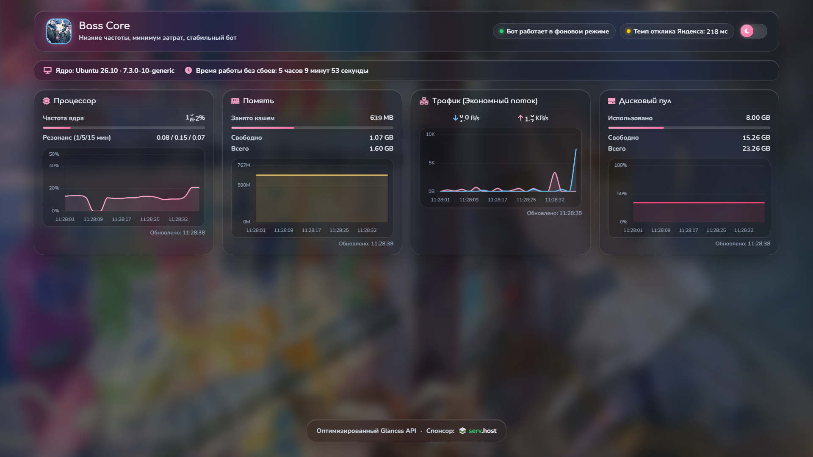

# 🎸 Bocchi Downloader — Server Status Dashboard

Красивый, анимированный дашборд мониторинга сервера \
Данные получаются через **Glances API**, отображаются в реальном времени и обновляются каждые 2 секунды.




> [!Important]
> ## Обнаружены особенности работы дашборда
> При использовании дашборда вы можете заметить некоторые нюансы, которые объясняются особенностями работы сети и браузеров. Ниже описаны две наиболее частые ситуации и способы их решения.

> [!Warning]
> ## Задержка отклика при обращении к Яндекс.Музыке кажется значительной
> Пинг Яндекс.Музыки, который можно увидеть на дашборде, измеряется с помощью HTTP/HTTPS-запросов. В норме он составляет примерно 180-200 миллисекунд. Этот показатель помогает проверить доступность веб-ресурса, оценить скорость загрузки страниц и обнаружить проблемы на прикладном уровне. Реальное время отклика ICMP составляет около 47 миллисекунд.

> [!Warning]
> ## Проблемы с отображением данных
> Иногда вы можете заметить, что на компьютере, телефоне или планшете данные на дашборде не совпадают. Это не ошибка дашборда и не сбой сервера, а особенность работы браузеров, которая называется **кешированием**.
> ### Что такое кеширование?
> Чтобы страницы загружались быстрее, браузер запоминает некоторые данные: картинки, стили, а иногда и ответы от сервера. Когда вы заходите на сайт повторно, браузер показывает сохранённую копию, а не запрашивает всё заново. Это экономит трафик и ускоряет работу.
> ### Почему это влияет на дашборд?
> Дашборд обновляет данные каждые 2 секунды — он показывает текущую загрузку процессора, памяти, сети и состояние бота. Но если браузер запомнил старый ответ от сервера, он может продолжать показывать устаревшие данные, даже если на сервере они уже изменились. Особенно это заметно, если вы долго не обновляли страницу или открыли её на одном устройстве, а потом зашли с другого — на одном устройстве может остаться старая версия.
> ### Это ошибка дашборда?
> Нет, это нормальное поведение любого браузера. Сам дашборд всегда показывает актуальные данные, которые получает напрямую из системы каждые 2 секунды. Проблема только в том, что браузер может «застрять» на старой версии. Режим инкогнито или жёсткая перезагрузка решают это мгновенно.
> 
> Если вы открыли дашборд в инкогнито и данные всё ещё не обновляются — значит, проблема не в кеше. \
> Если у вас возникли проблемы, пожалуйста, сообщите о них [здесь](https://github.com/YaroslavGrud/Bocchi-Downloader/issues). Мы обязательно поможем вам разобраться.

## 📊 Отображаемые метрики

*   Загрузка **CPU** (процент, график, load average)
*   Использование **оперативной памяти** (занято, свободно, всего)
*   **Сетевой трафик** (входящий/исходящий, автоматический выбор единиц)
*   Суммарное использование **дискового пространства**
*   **Время работы сервера** (на русском языке)
*   **Статус Docker-контейнера** `bocchi_bot` (онлайн/офлайн)
*   **Графики истории** (20 точек) для CPU, RAM и сети
*   **Пинг** напрямую с сервера до `music.yandex.ru`

## 🚀 Быстрый старт (Ubuntu 22.04/24.04)

### 1️⃣ Установка Glances

```bash
apt update && apt install -y pipx python3-dev
pipx ensurepath
source ~/.bashrc
pipx install 'glances[all]'
```

### 2️⃣ Запуск Glances как службы systemd

Создайте сервис:

```bash
cat > /etc/systemd/system/glances.service << 'EOF'
[Unit]
Description=Glances Web Server
After=network.target

[Service]
Type=simple
ExecStartPre=/bin/bash -c 'fuser -k 61208/tcp 2>/dev/null || true'
ExecStart=/root/.local/bin/glances -w --bind 0.0.0.0 --port 61208 -t 1 --disable-plugin smart --disable-plugin gpu
Restart=on-failure
RestartSec=5
User=root

[Install]
WantedBy=multi-user.target
EOF

systemctl daemon-reload
systemctl enable glances
systemctl start glances
```

Проверьте работу: `curl http://127.0.0.1:61208/api/4/cpu` → должен вернуть JSON.

### 3️⃣ Установка и настройка Nginx + FastAPI

```bash
apt install -y nginx
```
В `/etc/systemd/system/bocchi-dashboard.service` добавить:
```
[Unit]
Description=Bocchi Dashboard (FastAPI)
After=network.target

[Service]
WorkingDirectory=/root/bocchi_bot
ExecStart=/root/bocchi_bot/venv/bin/python -m uvicorn Dashboard_Endpoint:app --host 127.0.0.1 --port 61211
Restart=always
RestartSec=5

[Install]
WantedBy=multi-user.target

```
Затем запустить
```
systemctl daemon-reload
systemctl enable --now bocchi-dashboard
systemctl status bocchi-dashboard --no-pager
```

Создайте конфигурационный файл:

```bash
cat > /etc/nginx/sites-available/dashboard << 'EOF'
# Старый дашборд — без изменений (статика + API)
server {
    listen 61212;
    server_name _;

    root /var/www/dashboard;
    index index.html;

    location /api/ {
        proxy_pass http://127.0.0.1:61208;
        proxy_set_header Host 127.0.0.1:61208;
        proxy_set_header X-Real-IP $remote_addr;
        rewrite ^/api/(.*) /api/$1 break;
    }

    location /api/ping {
        proxy_pass http://127.0.0.1:61210/ping;
        proxy_set_header Host $host;
        proxy_set_header X-Real-IP $remote_addr;
    }

    location /os-release {
        alias /etc/os-release;
        default_type text/plain;
    }

    location / {
        try_files $uri $uri/ =404;
    }
}
# Новый дашборд — всё через FastAPI на 61211
server {
    listen 61209;
    server_name _;

    location / {
        proxy_pass http://127.0.0.1:61211;
        proxy_set_header Host $host;
        proxy_set_header X-Real-IP $remote_addr;
        proxy_set_header X-Forwarded-For $proxy_add_x_forwarded_for;
    }
}
EOF

ln -sf /etc/nginx/sites-available/dashboard /etc/nginx/sites-enabled/
rm -f /etc/nginx/sites-enabled/default
nginx -t && systemctl reload nginx
```

### 4️⃣ Размещение дашборда

Скопируйте содержимое файла [`bocchi_dashboard.html`](https://raw.githubusercontent.com/YaroslavGrud/Bocchi-Downloader/Yaroslav_grud/bocchi_dashboard.html) в `/var/www/dashboard/index.html`:

```bash
mkdir -p /var/www/dashboard
curl -o /var/www/dashboard/index.html https://raw.githubusercontent.com/YaroslavGrud/Bocchi-Downloader/Yaroslav_grud/bocchi_dashboard.html
```

### 5️⃣ Открыть порт в файрволе

```bash
ufw allow 61209/tcp
```
### 6 Пинг серверов Яндекс.Музыки

```bash
cat > /etc/systemd/system/ping_server.service <<'EOF'
[Unit]
Description=Ping server for Bocchi Dashboard
After=network.target

[Service]
WorkingDirectory=/root/bocchi_bot
ExecStart=/usr/bin/python3 /root/bocchi_bot/ping_server.py
Restart=always
RestartSec=10
User=root
Group=root
StandardOutput=journal
StandardError=journal

[Install]
WantedBy=multi-user.target
EOF

systemctl daemon-reload
systemctl enable ping_server.service
systemctl start ping_server.service
```

### 8 Проверка

Откройте браузер по адресу: `http://<IP-вашего-сервера>:61209`

Дашборд будет автоматически обновляться каждые 2 секунды. Если контейнер `bocchi_bot` запущен – вы увидите зелёную точку и надпись «Бот онлайн».

Если и это не помогло то делаем:
```
cd /root/bocchi_bot
cp Dashboard_Endpoint.py Dashboard_Endpoint.py.bak
cat > Dashboard_Endpoint.py << 'EOF'
import re
import time
import subprocess
from pathlib import Path

import httpx
import uvicorn
from fastapi import FastAPI, Response
from fastapi.staticfiles import StaticFiles

BASE_DIR = Path(__file__).resolve().parent
GLANCES = "http://127.0.0.1:61208"

app = FastAPI(title="Bocchi Dashboard API")

# --- Собственные эндпоинты (обязательно ДО catch-all прокси) ---

@app.get("/api/ping")
def api_ping():
    """Реальный замер сетевой задержки, а не random."""
    try:
        start = time.monotonic()
        httpx.get("https://ya.ru", timeout=3.0)
        latency = round((time.monotonic() - start) * 1000)
    except Exception:
        latency = -1
    return {"latency": latency}

@app.get("/api/4/containers")
def api_containers():
    """Честный статус контейнера из docker."""
    try:
        r = subprocess.run(
            ["docker", "inspect", "-f", "{{.State.Status}}", "bocchi_bot"],
            capture_output=True, text=True, timeout=5,
        )
        status = r.stdout.strip() or "missing"
    except Exception:
        status = "unknown"
    return [{"name": "bocchi_bot", "status": status}]

@app.get("/api/4/uptime")
def api_uptime():
    """Отдаёт аптайм в секундах — фронтенд-парсер это умеет."""
    try:
        r = httpx.get(f"{GLANCES}/api/4/uptime", timeout=3.0)
        s = r.json()
        if not isinstance(s, str):
            s = str(s)
        d = re.search(r"(\d+)\s*days?", s, re.I)
        hms = re.search(r"(\d+):(\d+):(\d+)", s)
        if d or hms:
            sec = int(d.group(1)) * 86400 if d else 0
            if hms:
                sec += int(hms.group(1)) * 3600 + int(hms.group(2)) * 60 + int(hms.group(3))
            return sec
        return s  # незнакомый формат — отдаём как есть
    except Exception:
        return Response(content="{}", status_code=502)

# --- Catch-all прокси в Glances (строго после эндпоинтов выше) ---

@app.get("/api/4/{path:path}")
def glances_proxy(path: str):
    r = httpx.get(f"{GLANCES}/api/4/{path}", timeout=5.0)
    return Response(
        content=r.content,
        media_type=r.headers.get("content-type", "application/json"),
    )

# --- Статика ---

@app.get("/")
def index():
    return Response(
        content=(BASE_DIR / "bocchi_dashboard.html").read_bytes(),
        media_type="text/html",
    )

app.mount("/assets", StaticFiles(directory=str(BASE_DIR / "assets")), name="assets")

if __name__ == "__main__":
    # Порт 61209 занят Nginx — живём на внутреннем 61211
    uvicorn.run(app, host="127.0.0.1", port=61211)
EOF
```

## ⚙️ Проблемы и решения

| Проблема                                            | Решение                                                                                                                                                                                         |
|-----------------------------------------------------|-------------------------------------------------------------------------------------------------------------------------------------------------------------------------------------------------|
| `curl http://127.0.0.1:61208/api/4/cpu` не работает | Glances не запущен. Проверьте `systemctl status glances`.                                                                                                                                       |
| Дашборд показывает `{"detail":"Not Found"}`         | Убедитесь, что Nginx проксирует `/api/` на порт 61208. Проверьте конфиг и перезагрузите Nginx.                                                                                                  |
| Данные нулевые                                      | Откройте консоль браузера (F12). Если запросы к `/api/4/...` возвращают 404 – проблема в Nginx. Если возвращают JSON, но дашборд не обновляется – возможно, ошибка в JavaScript (маловероятно). |
| Диск отображается как 0 GB                          | Убедитесь, что в `curl http://127.0.0.1:61208/api/4/fs` есть разделы. Суммируются только разделы с `fs_type` не `squashfs`, `tmpfs`, `devtmpfs`, `overlay` и не `/snap/*`.                      |
| Не отображается статус бота                         | Проверьте, что контейнер `bocchi_bot` запущен. Запрос `curl http://127.0.0.1:61208/api/4/containers` должен показывать контейнер с именем `bocchi_bot`.                                         |
| Графики не строятся                                 | Подождите 10 секунд – графики заполняются историей. Убедитесь, что в консоли нет ошибок JavaScript.                                                                                             |

## 🧹 Обновление дашборда

> [!Tip]
> Если `bocchi_dashboard.html` был обновлён в репозитории, просто перезапишите файл:
```bash
curl -o /var/www/dashboard/index.html https://raw.githubusercontent.com/YaroslavGrud/Bocchi-Downloader/Yaroslav_grud/bocchi_dashboard.html
```
Затем обновите страницу в браузере (Ctrl+F5).

## 🙏 Благодарности

*   [Glances](https://github.com/nicolargo/glances) – инструмент сбора метрик.
*   [Chart.js](https://www.chartjs.org/) – библиотека для графиков.
*   Font Awesome – иконки.
